# 📱 BizPocket - Complete Project Documentation

**Version**: 1.0.0  
**Date**: January 22, 2026  
**Project Type**: Progressive Web Application (PWA)  
**Platform**: Cross-platform (Web, Android, iOS)

---

## 📑 Table of Contents

1. [Executive Summary](#1-executive-summary)
2. [Project Overview](#2-project-overview)
3. [Technology Stack](#3-technology-stack)
4. [System Architecture](#4-system-architecture)
5. [Database Schema](#5-database-schema)
6. [Features & Functionality](#6-features--functionality)
7. [API Integrations](#7-api-integrations)
8. [User Flow Diagrams](#8-user-flow-diagrams)
9. [Component Structure](#9-component-structure)
10. [Authentication & Security](#10-authentication--security)
11. [Deployment](#11-deployment)
12. [Environment Configuration](#12-environment-configuration)
13. [Development Workflow](#13-development-workflow)
14. [Recent Updates](#14-recent-updates)
15. [Future Enhancements](#15-future-enhancements)

---

## 1. Executive Summary

**BizPocket** is a modern Progressive Web Application designed for scanning, organizing, and managing various types of business documents including:
- Business Cards
- Invoices
- Receipts  
- LinkedIn QR Codes

The application leverages cutting-edge technologies including:
- **OCR (Optical Character Recognition)** via Tesseract.js
- **AI-powered text structuring** via Groq API
- **QR Code scanning** for LinkedIn profiles
- **Cloud storage** with Supabase
- **Real-time data synchronization**

**Key Highlights**:
- ✅ Cross-platform compatibility (Web, Android, iOS)
- ✅ Offline-first architecture
- ✅ Real-time AI-powered data extraction
- ✅ Secure authentication with email verification
- ✅ Cloud-based storage and synchronization

---

## 2. Project Overview

### 2.1 Project Purpose

BizPocket streamlines the process of digitizing and organizing business documents by:
1. Capturing images via camera or file upload
2. Extracting text using OCR technology
3. Structuring data using AI
4. Storing securely in the cloud
5. Providing easy access and management

### 2.2 Target Audience

- **Business Professionals**: Managing business cards and contacts
- **Accountants & Bookkeepers**: Organizing invoices and receipts
- **Sales Teams**: Collecting and managing client information
- **Freelancers & Entrepreneurs**: Tracking expenses and networking

### 2.3 Key Benefits

| Benefit | Description |
|---------|-------------|
| **Time Saving** | Auto-extract data from scans in seconds |
| **Organization** | Centralized storage for all business documents |
| **Accessibility** | Access from any device, anywhere |
| **Security** | Enterprise-grade security with Supabase |
| **AI-Powered** | Intelligent data extraction and structuring |

---

## 3. Technology Stack

### 3.1 Frontend Technologies

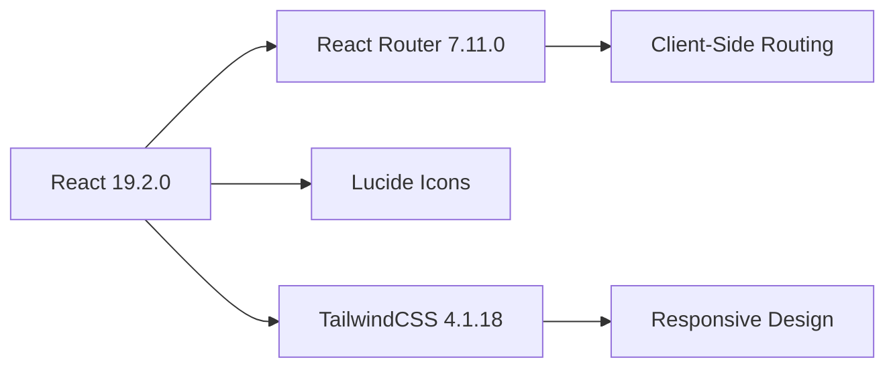

| Technology | Version | Purpose |
|------------|---------|---------|
| **React** | 19.2.0 | UI Framework |
| **React Router DOM** | 7.11.0 | Client-side routing |
| **Vite** | 7.2.4 | Build tool & dev server |
| **TailwindCSS** | 4.1.18 | Utility-first CSS framework |
| **Lucide React** | 0.562.0 | Icon library |

### 3.2 Backend & Services

| Service | Technology | Purpose |
|---------|------------|---------|
| **Database** | Supabase (PostgreSQL) | Data storage & authentication |
| **Storage** | Supabase Storage | Image file storage |
| **OCR** | Tesseract.js 7.0.0 | Optical character recognition |
| **QR Scanner** | html5-qrcode 2.3.8 | QR code detection |
| **AI Processing** | Groq API (LLaMA 3.3 70B) | Text structuring & extraction |

### 3.3 Development Tools

```javascript
{
  "devDependencies": {
    "@vitejs/plugin-react": "^5.1.1",
    "eslint": "^9.39.1",
    "eslint-plugin-react-hooks": "^7.0.1",
    "eslint-plugin-react-refresh": "^0.4.24"
  }
}
```

### 3.4 Programming Languages

- **JavaScript** (ES6+): 100% of codebase
- **SQL**: Database migrations
- **CSS**: Styling (via TailwindCSS)
- **HTML**: JSX templates

---

## 4. System Architecture

### 4.1 High-Level Architecture

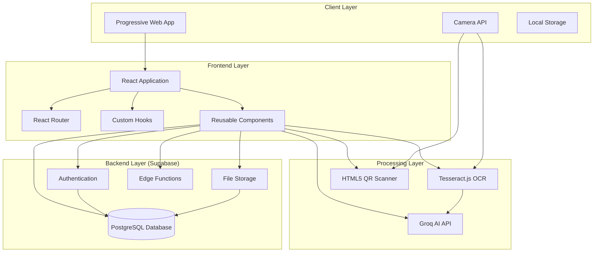

### 4.2 Application Flow

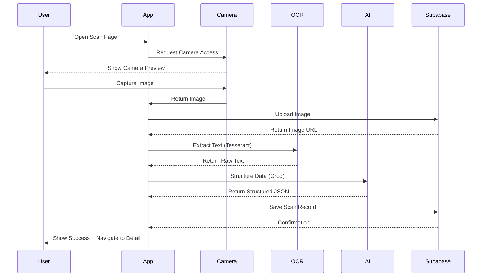

### 4.3 Data Flow Architecture

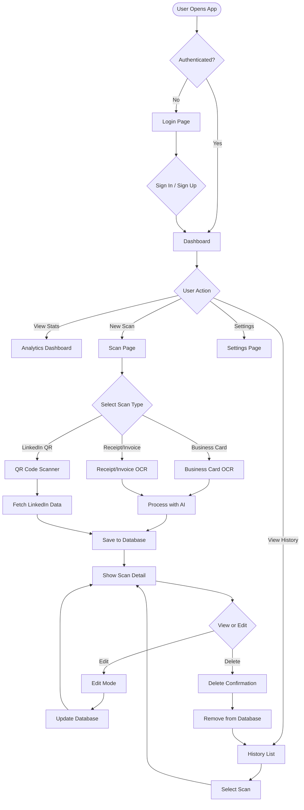

---

## 5. Database Schema

### 5.1 Database Structure

**Database**: PostgreSQL (via Supabase)  
**ORM**: Supabase Client SDK

### 5.2 Core Tables

#### 5.2.1 Scans Table

```sql
CREATE TABLE scans (
  id UUID PRIMARY KEY DEFAULT gen_random_uuid(),
  user_id UUID REFERENCES auth.users(id) ON DELETE CASCADE,
  type TEXT CHECK (type IN ('business_card', 'receipt', 'invoice', 'linkedin_qr', 'other')),
  image_url TEXT,
  raw_text TEXT,
  structured_json JSONB,
  created_at TIMESTAMPTZ DEFAULT NOW(),
  updated_at TIMESTAMPTZ DEFAULT NOW()
);
```

**Indexes**:
- `idx_scans_user_id` on `user_id`
- `idx_scans_type` on `type`
- `idx_scans_created_at` on `created_at`

#### 5.2.2 Profiles Table

```sql
CREATE TABLE profiles (
  id UUID PRIMARY KEY REFERENCES auth.users(id) ON DELETE CASCADE,
  full_name TEXT,
  currency TEXT DEFAULT 'INR',
  theme TEXT DEFAULT 'dark',
  notification_enabled BOOLEAN DEFAULT true,
  created_at TIMESTAMPTZ DEFAULT NOW(),
  updated_at TIMESTAMPTZ DEFAULT NOW()
);
```

#### 5.2.3 Invoice Templates Table

```sql
CREATE TABLE invoice_templates (
  id UUID PRIMARY KEY DEFAULT gen_random_uuid(),
  vendor_name TEXT NOT NULL,
  vendor_patterns TEXT[] DEFAULT '{}',
  gstin TEXT,
  field_mappings JSONB,
  sample_extraction JSONB,
  usage_count INTEGER DEFAULT 0,
  accuracy_score DECIMAL(3,2),
  created_at TIMESTAMPTZ DEFAULT NOW(),
  updated_at TIMESTAMPTZ DEFAULT NOW()
);
```

**Purpose**: Stores known vendor formats for improved extraction accuracy.

#### 5.2.4 Extraction Feedback Table

```sql
CREATE TABLE extraction_feedback (
  id UUID PRIMARY KEY DEFAULT gen_random_uuid(),
  scan_id UUID REFERENCES scans(id) ON DELETE CASCADE,
  user_id UUID REFERENCES auth.users(id) ON DELETE CASCADE,
  original_extraction JSONB NOT NULL,
  user_correction JSONB NOT NULL,
  field_corrections TEXT[] DEFAULT '{}',
  extraction_method TEXT,
  scan_type TEXT,
  vendor_matched TEXT,
  created_at TIMESTAMPTZ DEFAULT NOW()
);
```

**Purpose**: Machine learning feedback loop for improving extraction over time.

### 5.3 Entity Relationship Diagram

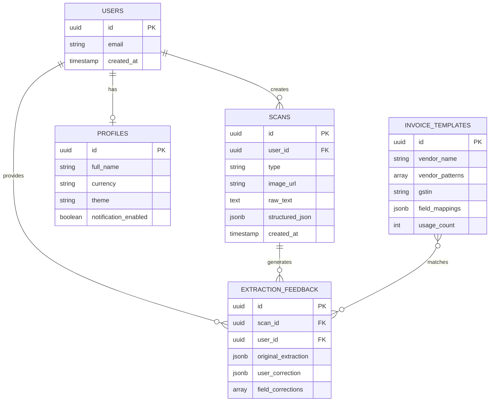

### 5.4 Row Level Security (RLS)

All tables have **Row Level Security** enabled:

```sql
-- Example: Users can only see their own scans
CREATE POLICY "Users can view own scans"
  ON scans FOR SELECT
  USING (auth.uid() = user_id);

CREATE POLICY "Users can insert own scans"
  ON scans FOR INSERT
  WITH CHECK (auth.uid() = user_id);

CREATE POLICY "Users can update own scans"
  ON scans FOR UPDATE
  USING (auth.uid() = user_id);

CREATE POLICY "Users can delete own scans"
  ON scans FOR DELETE
  USING (auth.uid() = user_id);
```

---

## 6. Features & Functionality

### 6.1 Authentication Features

| Feature | Description | Implementation |
|---------|-------------|----------------|
| **Email/Password Login** | Standard authentication | Supabase Auth |
| **Email Verification** | Confirms user email | Supabase Email Templates |
| **Password Reset** | Forgot password flow | Supabase Auth with email link |
| **Session Management** | Persistent sessions | LocalStorage + Supabase |
| **Protected Routes** | Auth-required pages | React Router guards |

### 6.2 Scanning Features

#### 6.2.1 Business Card Scanning

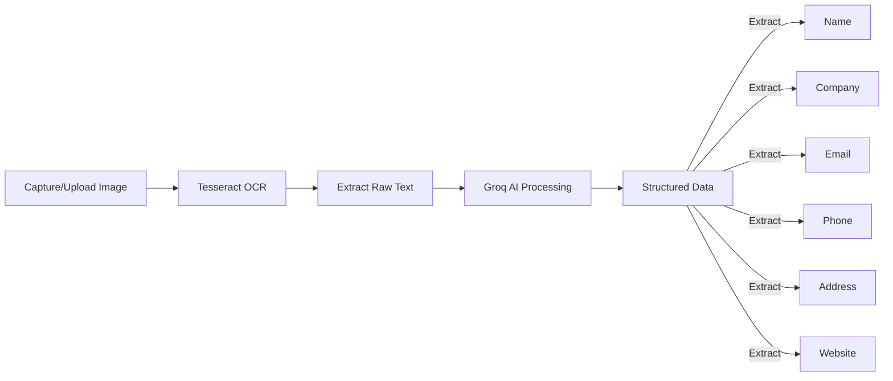

**Extracted Fields**:
- Name
- Company
- Title/Position
- Email
- Phone
- Website
- Address

#### 6.2.2 Invoice/Receipt Scanning

**Extracted Fields**:
- Merchant Name
- Date
- Total Amount
- Tax Amount
- Subtotal
- Currency
- Invoice Number

#### 6.2.3 LinkedIn QR Code Scanning

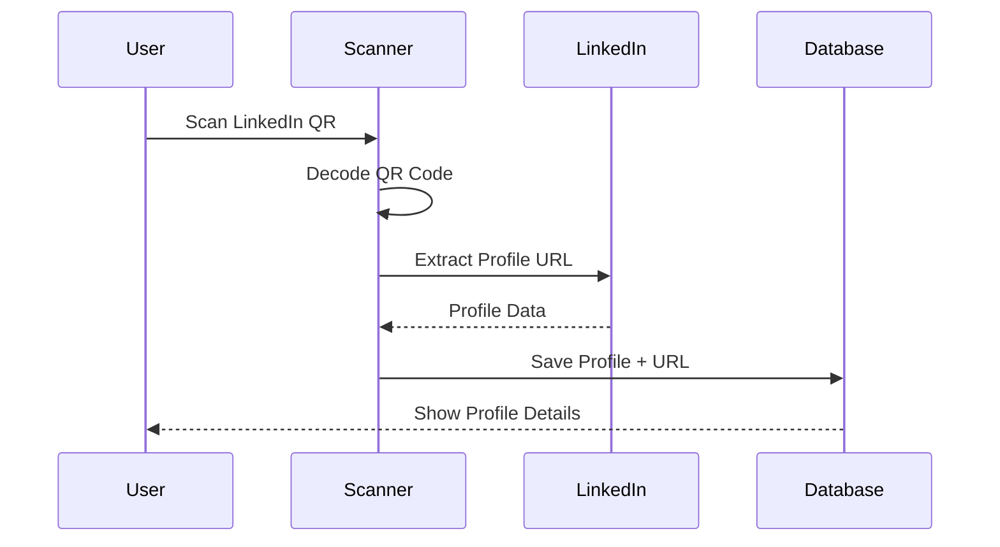

**Captured Data**:
- Name
- Headline
- Company
- Certifications
- LinkedIn Profile URL

### 6.3 Management Features

| Feature | Description |
|---------|-------------|
| **History View** | Browse all scans with filters |
| **Search & Filter** | Find scans by type or date |
| **Edit Scans** | Modify extracted data |
| **Delete Scans** | Remove unwanted scans |
| **Detailed View** | View comprehensive scan information |

### 6.4 Settings & Preferences

- **Theme Toggle**: Dark/Light mode
- **Currency Selection**: INR, USD, EUR, GBP, JPY, etc.
- **Profile Management**: Update name and preferences
- **Logout**: Secure session termination

---

## 7. API Integrations

### 7.1 Supabase API

**Base Configuration**:
```javascript
import { createClient } from '@supabase/supabase-js';

const supabase = createClient(
  process.env.VITE_SUPABASE_URL,
  process.env.VITE_SUPABASE_ANON_KEY
);
```

**Key Functions**:

| Function | Purpose | Endpoint |
|----------|---------|----------|
| `signIn(email, password)` | User authentication | `auth.signInWithPassword` |
| `signUp(email, password)` | User registration | `auth.signUp` |
| `signOut()` | Session termination | `auth.signOut` |
| `getCurrentUser()` | Get auth session | `auth.getUser` |
| `uploadImage(file, userId)` | Upload scan images | `storage.from('scans').upload` |
| `insertScan(data)` | Save scan record | `from('scans').insert` |
| `getScans(userId, type)` | Fetch user scans | `from('scans').select` |
| `updateScan(id, updates)` | Edit scan data | `from('scans').update` |
| `deleteScan(id)` | Remove scan | `from('scans').delete` |

### 7.2 Groq AI API

**Configuration**:
```javascript
const GROQ_API_KEY = import.meta.env.VITE_GROQ_API_KEY;
const GROQ_API_URL = 'https://api.groq.com/openai/v1/chat/completions';
```

**Model Used**: `llama-3.3-70b-versatile`

**Purpose**: Structures raw OCR text into JSON format

**Request Flow**:
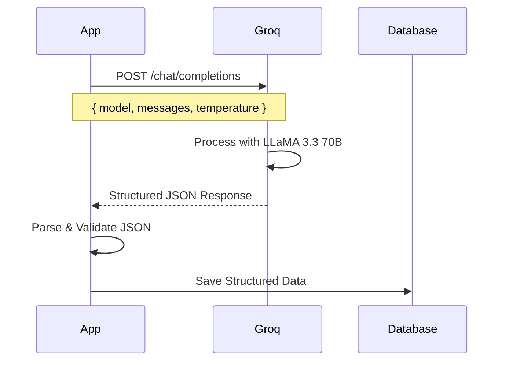

**Example AI Prompt**:
```
Extract business card information from this text and return 
ONLY valid JSON with fields: name, company, title, email, 
phone, website, address. Text: [OCR_TEXT]
```

### 7.3 Tesseract.js OCR

**Configuration**:
```javascript
import { createWorker } from 'tesseract.js';

const worker = await createWorker('eng');
const { data: { text } } = await worker.recognize(image);
```

**Supported Languages**: English (eng)

**Image Preprocessing**:
- Grayscale conversion
- Contrast enhancement
- Noise reduction

### 7.4 HTML5 QR Code Scanner

**Library**: `html5-qrcode` v2.3.8

**Configuration**:
```javascript
import { Html5QrcodeScanner } from 'html5-qrcode';

const scanner = new Html5QrcodeScanner(
  'reader',
  { fps: 10, qrbox: { width: 250, height: 250 } }
);
```

**Supported Sources**:
- Camera (front/back)
- File upload
- Gallery selection

---

## 8. User Flow Diagrams

### 8.1 Authentication Flow

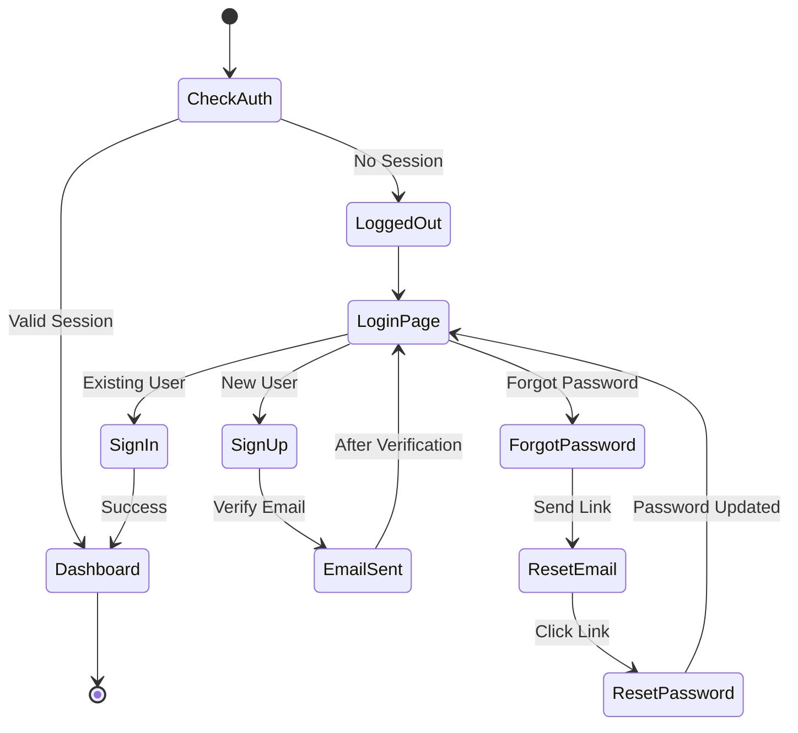

### 8.2 Scanning Flow

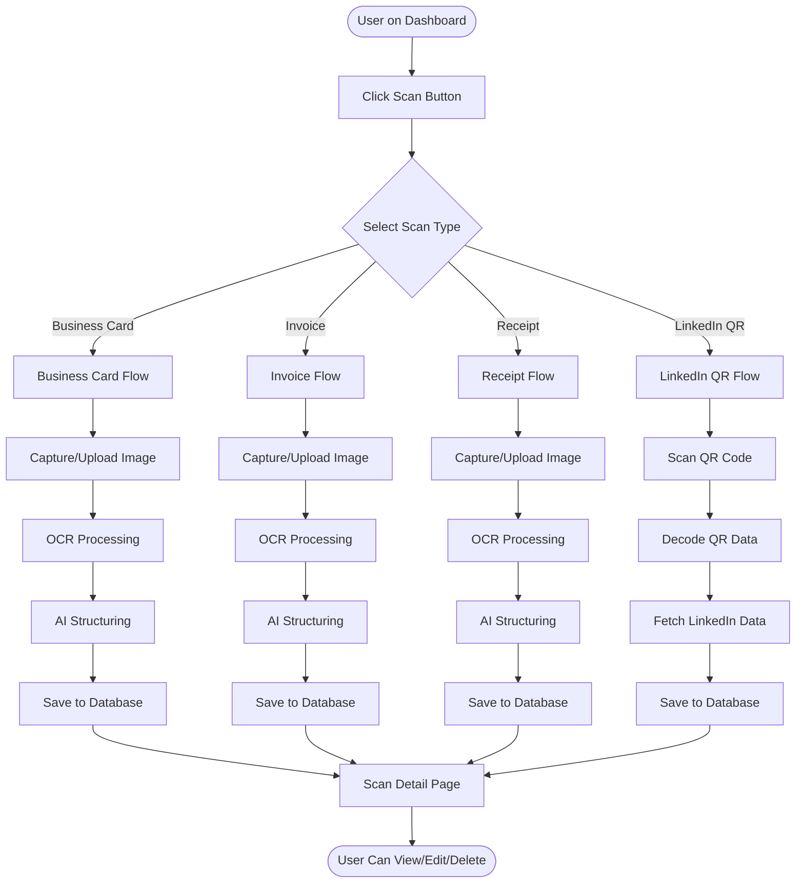

### 8.3 Edit & Delete Flow

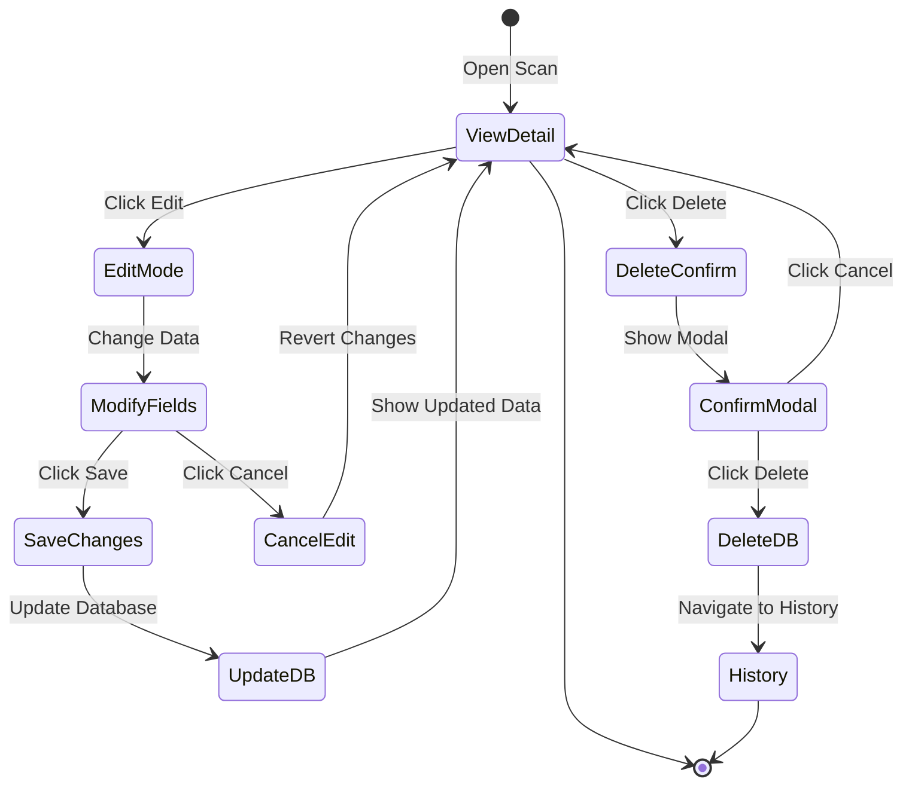

---

## 9. Component Structure

### 9.1 Project File Structure

```
bizpocket1/
├── public/
│   ├── icons/               # PWA icons
│   └── manifest.json        # PWA manifest
├── src/
│   ├── assets/             # Static assets
│   ├── components/
│   │   ├── layout/
│   │   │   ├── AppShell.jsx      # Main app container
│   │   │   ├── BottomNav.jsx     # Mobile navigation
│   │   │   ├── Header.jsx        # Page header
│   │   │   └── PageWrapper.jsx   # Page content wrapper
│   │   └── ui/
│   │       ├── Badge.jsx         # Badge component
│   │       ├── Button.jsx        # Button component
│   │       ├── Card.jsx          # Card container
│   │       ├── ErrorBoundary.jsx # Error handling
│   │       ├── Input.jsx         # Form inputs
│   │       ├── Modal.jsx         # Modal dialogs
│   │       ├── Spinner.jsx       # Loading indicators
│   │       └── IOSInstallPrompt.jsx # PWA install
│   ├── hooks/
│   │   ├── useAuth.js       # Authentication hook
│   │   ├── useTheme.js      # Theme management
│   │   ├── useToast.js      # Toast notifications
│   │   └── useUtils.js      # Utility hooks
│   ├── lib/
│   │   ├── ai.js           # Groq AI integration
│   │   ├── ocr.js          # Tesseract OCR
│   │   ├── qrcode.js       # QR code scanner
│   │   ├── supabase.js     # Supabase client
│   │   └── utils.js        # Helper functions
│   ├── pages/
│   │   ├── Auth.jsx              # Login/Signup
│   │   ├── AuthCallback.jsx      # Email verification
│   │   ├── Dashboard.jsx         # Home dashboard
│   │   ├── ForgotPassword.jsx    # Password reset request
│   │   ├── History.jsx           # Scan history list
│   │   ├── ResetPassword.jsx     # Password reset form
│   │   ├── Scan.jsx              # Scanning interface
│   │   ├── ScanDetail.jsx        # Scan detail view
│   │   └── Settings.jsx          # User settings
│   ├── App.jsx              # Root component
│   ├── App.css             # Global styles
│   ├── index.css           # Tailwind imports
│   └── main.jsx            # Application entry
├── supabase/
│   ├── functions/          # Edge functions
│   └── migrations/         # Database migrations
│       ├── 001_invoice_templates.sql
│       ├── 002_extraction_feedback.sql
│       └── 003_add_linkedin_qr_type.sql
├── .env                    # Environment variables
├── .env.example            # Environment template
├── package.json            # Dependencies
├── vite.config.js          # Vite configuration
└── README.md              # Project readme
```

### 9.2 Component Hierarchy

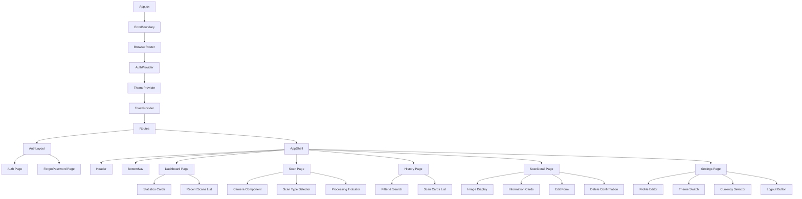

### 9.3 Key Components

#### Layout Components

| Component | Path | Purpose |
|-----------|------|---------|
| **AppShell** | `components/layout/AppShell.jsx` | Authenticated app container |
| **BottomNav** | `components/layout/BottomNav.jsx` | Mobile navigation bar |
| **Header** | `components/layout/Header.jsx` | Page header with title |
| **PageWrapper** | `components/layout/PageWrapper.jsx` | Content wrapper with padding |

#### UI Components

| Component | Path | Purpose |
|-----------|------|---------|
| **Badge** | `components/ui/Badge.jsx` | Colored labels |
| **Button** | `components/ui/Button.jsx` | Interactive buttons |
| **Card** | `components/ui/Card.jsx` | Content containers |
| **Input** | `components/ui/Input.jsx` | Form inputs & textareas |
| **Modal** | `components/ui/Modal.jsx` | Dialog overlays |
| **Spinner** | `components/ui/Spinner.jsx` | Loading indicators |

#### Custom Hooks

| Hook | Path | Purpose |
|------|------|---------|
| **useAuth** | `hooks/useAuth.js` | Authentication state & methods |
| **useTheme** | `hooks/useTheme.js` | Theme & currency management |
| **useToast** | `hooks/useToast.js` | Toast notifications |
| **useUtils** | `hooks/useUtils.js` | Online status, debounce, etc. |

---

## 10. Authentication & Security

### 10.1 Authentication Strategy

**Provider**: Supabase Authentication  
**Method**: Email/Password + Email Verification

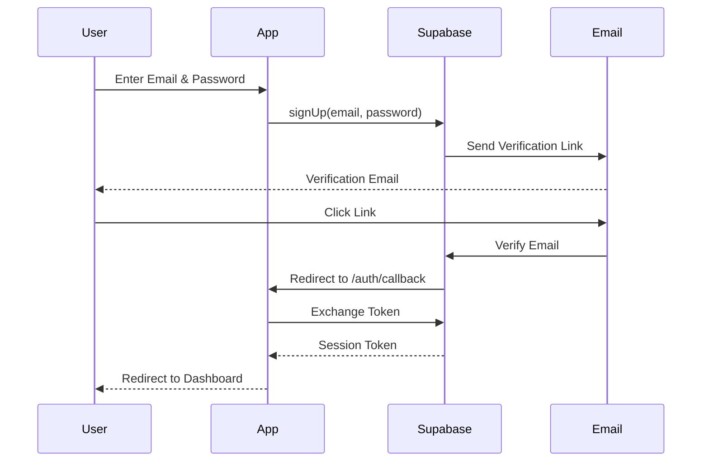

### 10.2 Session Management

**Storage**: LocalStorage (Supabase handles it)  
**Expiration**: Configurable (default: 1 hour)  
**Refresh**: Automatic token refresh

```javascript
// Auto-refresh session
supabase.auth.onAuthStateChange((event, session) => {
  if (event === 'SIGNED_IN') {
    // User logged in
  }
  if (event === 'SIGNED_OUT') {
    // User logged out
  }
  if (event === 'TOKEN_REFRESHED') {
    // Session refreshed
  }
});
```

### 10.3 Security Features

| Feature | Implementation |
|---------|----------------|
| **Password Hashing** | Handled by Supabase (bcrypt) |
| **JWT Tokens** | Supabase issues signed JWTs |
| **Row Level Security** | PostgreSQL RLS policies|
| **HTTPS Only** | Enforced by Supabase & Vercel |
| **CORS Protection** | Configured in Supabase |
| **XSS Protection** | React escapes by default |
| **CSRF Protection** | Supabase JWT validation |

### 10.4 Environment Variables

**Required Variables**:
```bash
VITE_SUPABASE_URL=your_supabase_project_url
VITE_SUPABASE_ANON_KEY=your_supabase_anon_key
VITE_GROQ_API_KEY=your_groq_api_key (optional)
```

**Security Best Practices**:
- ✅ Never commit `.env` to version control
- ✅ Use `.env.example` as template
- ✅ Rotate API keys regularly
- ✅ Use environment-specific keys (dev/prod)

---

## 11. Deployment

### 11.1 Deployment Platform

**Platform**: Vercel  
**Repository**: GitHub  
**Branch**: `development` (auto-deploy)

### 11.2 Build Configuration

```json
{
  "scripts": {
    "dev": "vite",
    "build": "vite build",
    "preview": "vite preview"
  }
}
```

**Build Command**: `npm run build`  
**Output Directory**: `dist/`  
**Node Version**: 18.x or higher

### 11.3 Deployment Process

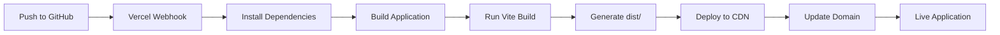

**Deployment Steps**:
1. Push code to GitHub `development` branch
2. Vercel automatically detects changes
3. Runs `npm install`
4. Runs `npm run build`
5. Deploys to global CDN
6. Updates production URL

### 11.4 Environment Setup in Vercel

Navigate to: **Vercel Dashboard → Project → Settings → Environment Variables**

Add:
- `VITE_SUPABASE_URL`
- `VITE_SUPABASE_ANON_KEY`
- `VITE_GROQ_API_KEY`

### 11.5 Custom Domain (if configured)

**Example**: `bizpocket.vercel.app` or custom domain

**DNS Configuration**:
```
A Record: @ → 76.76.21.21
CNAME: www → cname.vercel-dns.com
```

---

## 12. Environment Configuration

### 12.1 Development Setup

**Prerequisites**:
- Node.js 18+ 
- npm or yarn
- Git

**Installation Steps**:
```bash
# Clone repository
git clone https://github.com/ASIK1506/PocketScan.git
cd bizpocket1

# Install dependencies
npm install

# Copy environment template
cp .env.example .env

# Edit .env with your credentials
# VITE_SUPABASE_URL=...
# VITE_SUPABASE_ANON_KEY=...
# VITE_GROQ_API_KEY=...

# Start development server
npm run dev
```

**Development Server**: `http://localhost:5173`

### 12.2 Supabase Setup

1. Create account at [supabase.com](https://supabase.com)
2. Create new project
3. Navigate to **Settings → API**
4. Copy:
   - Project URL → `VITE_SUPABASE_URL`
   - Anon/Public Key → `VITE_SUPABASE_ANON_KEY`
5. Run database migrations from `supabase/migrations/`

### 12.3 Groq API Setup (Optional)

1. Create account at [groq.com](https://groq.com)
2. Generate API key
3. Add to `.env`:
   ```
   VITE_GROQ_API_KEY=gsk_...
   ```

**Note**: If Groq key is not provided, basic parsing will be used.

---

## 13. Development Workflow

### 13.1 Git Workflow

**Branches**:
- `main`: Production-ready code
- `development`: Active development (auto-deploy to staging)
- `feature/*`: Feature branches

**Commit Convention**:
```
Feat: Add LinkedIn QR scanning feature
Fix: Modal visibility on mobile devices
Chore: Update dependencies
Docs: Update README
```

### 13.2 Development Commands

```bash
# Start dev server
npm run dev

# Build for production
npm run build

# Preview production build
npm run preview

# Lint code
npm run lint
```

### 13.3 Code Organization

**Best Practices**:
- ✅ Components in PascalCase (e.g., `ScanDetail.jsx`)
- ✅ Utilities in camelCase (e.g., `formatDate.js`)
- ✅ Constants in UPPER_CASE (e.g., `STORAGE_BUCKET`)
- ✅ One component per file
- ✅ Extract reusable logic to hooks

---

## 14. Recent Updates

### 14.1 Latest Changes (January 2026)

#### Fix: Modal Visibility on Mobile Devices
**Date**: 2026-01-22  
**Commit**: `fd40125`

**Problem**: Confirmation dialogs (Delete, Logout) were hidden behind the bottom navigation footer on Android and iPad devices.

**Solution**:
- Changed modal positioning from `items-end sm:items-center` to `items-center` (always centered)
- Increased z-index from `50` to `60`
- Added bottom margin (`mb-16 md:mb-0`) for mobile spacing

**Files Modified**:
- `src/components/ui/Modal.jsx`

#### Fix: LinkedIn URL Overflow
**Date**: 2026-01-22  
**Commit**: `6ecafd3`

**Problem**: Long LinkedIn URLs were extending outside their container box.

**Solution**:
- Added `min-w-0` to flex container (enables truncation)
- Added `flex-shrink-0` to LinkedIn icon
- Added `break-all` to URL text

**Files Modified**:
- `src/pages/ScanDetail.jsx`

### 14.2 Feature History

| Date | Feature | Description |
|------|---------|-------------|
| Jan 2026 | LinkedIn QR Scanning | Added LinkedIn profile QR code support |
| Jan 2026 | Password Reset | Implemented forgot password flow |
| Jan 2026 | Extraction Feedback | Added ML feedback loop for improvements |
| Jan 2026 | Invoice Templates | Vendor-specific extraction templates |

---

## 15. Future Enhancements

### 15.1 Planned Features

#### Phase 1 (Q1 2026)
- [ ] **Bulk Scanning**: Scan multiple documents at once
- [ ] **Export to PDF/CSV**: Download scans as PDF or spreadsheet
- [ ] **Cloud Sync**: Real-time sync across devices
- [ ] **Offline Mode**: Full offline functionality with sync when online

#### Phase 2 (Q2 2026)
- [ ] **AI-Powered Search**: Natural language search through scans
- [ ] **Contact Integration**: Export business cards to contacts
- [ ] **Calendar Integration**: Add invoice due dates to calendar
- [ ] **Receipt Analytics**: Expense tracking and reporting

#### Phase 3 (Q3 2026)
- [ ] **Team Collaboration**: Share scans with team members
- [ ] **Mobile Apps**: Native iOS and Android apps
- [ ] **API Access**: Developer API for third-party integrations
- [ ] **Advanced OCR**: Support for handwritten text

### 15.2 Technical Improvements

- [ ] **TypeScript Migration**: Add type safety
- [ ] **Unit Testing**: Add Jest + React Testing Library
- [ ] **E2E Testing**: Add Playwright tests
- [ ] **Performance Optimization**: Code splitting, lazy loading
- [ ] **PWA Enhancements**: Better offline support, push notifications

### 15.3 UI/UX Enhancements

- [ ] **Onboarding Tutorial**: Guide new users through features
- [ ] **Keyboard Shortcuts**: Power user shortcuts
- [ ] **Drag & Drop**: Upload images via drag & drop
- [ ] **Animations**: Smooth transitions and micro-interactions

---

## 📄 Appendix

### A. Glossary

| Term | Definition |
|------|------------|
| **OCR** | Optical Character Recognition - converting images of text to actual text |
| **PWA** | Progressive Web App - web app that can be installed like a native app |
| **RLS** | Row Level Security - database-level security policies |
| **JWT** | JSON Web Token - secure way to transmit information |
| **CDN** | Content Delivery Network - distributed server network for fast delivery |


---

## 📝 Document Information

**Document Version**: 1.0.0  
**Last Updated**: January 22, 2026  
**Maintained By**: Development Team  
**Status**: ✅ Active Development

---

**For questions or support, please contact the development team.**
